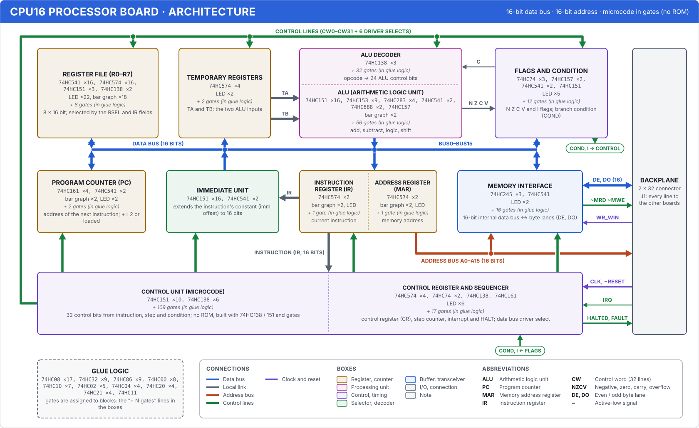
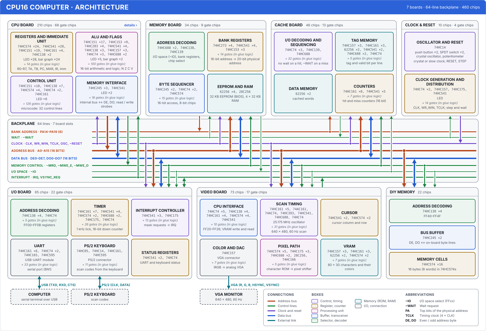

# Architecture (block) diagrams

There are three block diagrams: the CPU16 processor board, the whole CPU16 computer (seven boards, the
backplane and external devices) and the 8-bit calculator. Each box is a functional block of a board: its
name, a one-line role and the chips inside it. Nobody types the part lists and counts in the boxes; they are
counted from the circuit (`cpu16/board/`, `hesap8/kart.ts`). Lines are paths between boxes, and each one is
tied to real nets. If the circuit changes and a connection breaks, or an arrow's direction does not match
the pins, the tests fail.

You can see the diagrams in three places:

- In the app, under Silikon3D → Architecture (`#mimari`, `#mimari/cpu`, `#mimari/makine`,
  `#mimari/hesap`). You can pan and zoom, highlight a box's paths and see the box's chips. "Show in 3D"
  takes you to that block.
- In this document, as the SVGs below. Their sources are under `cpu16/docs/img/` and `hesap8/docs/img/`,
  and `npm run cpu16 -- mimari` generates them.
- In the build guides: an A4 landscape "Architecture" page after the cover of the breadboard index document
  (`npm run cpu16 -- breadboard-belge hepsi`) and of the calculator's breadboard document
  (`npm run hesap8 -- breadboard-belge`).

## CPU16 processor board



There is a single 16-bit internal data bus (BUS0–BUS15). In each clock cycle the control unit selects one
driver (the `~SRC_*` lines), and the load bits of the control word say which registers load from the bus.
An instruction takes several cycles: fetch (PC → MAR, memory → IR), decode, execute. Details are in
[mikromimari.en.md](mikromimari.en.md).

| Box | Role |
|---|---|
| Register file (R0–R7) | 8 × 16-bit registers; RSEL and fields in IR select which one is read and written |
| Temporary registers | TA and TB, the two ALU inputs. They load from the bus and feed the ALU over separate lines (TA, TB) |
| ALU | At the top, a decoder that derives 24 control bits from the operation code; below it, the adders (4 × 74HC283), logic and shift. Drives its result onto the internal data bus |
| Flags and condition | The N Z C V and I flags. They load from the ALU's result bits and give the branch condition (COND) to the control unit; the carry bit (C) goes back to the ALU |
| Program counter (PC) | The address of the next instruction: += 2, or loaded from the bus (branch, call) |
| Immediate unit | Sign-extends the immediate or offset in the instruction (the low bits of IR) to 16 bits and drives it onto the bus |
| MAR and IR | IR holds the running instruction and feeds it to the control unit and the immediate unit. MAR holds the address to access and drives the backplane address bus (A0–A15) directly |
| Memory interface | Connects the 16-bit internal data bus to the two byte lanes on the backplane (DE for even, DO for odd addresses); generates the read and write strobes (~MRD, ~MWE_E, ~MWE_O) |
| Control | On the left, the microcode: 32 control lines from instruction, step and condition. No ROM; it is built from 74HC138 / 151 and gates. On the right, the control register (CR), step counter, interrupt and HALT |
| Backplane | J1, a 2 × 32 connector: every line that goes to the other boards |
| Glue logic | 74HC00 / 08 / 32 … chips. Their gates are spread over different blocks; each box lists its own gate count as "+ N gates (in glue logic)" |

| Path | Nets | From → to |
|---|---|---|
| Internal data bus (16 bits) | BUS0–BUS15 | drivers: register file, ALU, flags, PC, immediate unit, memory interface; readers: all of them plus TA / TB, IR / MAR |
| TA, TB (16 bits) | TA0–TA15, TB0–TB15 | temporary registers → ALU |
| N Z C V, C | RES15, Z_ALU, C_ALU, V_ALU; ~CFLAG | ALU → flags; carry flag → ALU |
| IR, Instruction (IR) | IR0–IR11, IR0–IR15 | IR → immediate unit, IR → control unit |
| Control lines | CW0–CW31, ~SRC_* | control unit → all units |
| Condition, I | COND, IFLAG | flags → control unit |
| Address bus (16 bits) | A0–A15 | MAR → backplane (the memory interface reads A0 for byte select) |
| Data (16 bits) | DE0–DE7, DO0–DO7 | memory interface ↔ backplane |
| ~MRD ~MWE, WR_WIN | ~MRD, ~MWE_E, ~MWE_O; WR_WIN | memory interface → backplane; write window from the clock board |
| CLK, ~RESET; IRQ; HALTED, FAULT | | backplane → control unit; control unit → backplane (LEDs) |

## The whole computer



Seven boards plug into the same 64-line backplane ([anakart-kartlari.en.md](anakart-kartlari.en.md),
[anakart-gc-video.en.md](anakart-gc-video.en.md)). The band across the middle of the diagram is the
backplane: each lane is a group of lines, and each board's branch drops down to the lanes it uses. The
board frames contain the board's blocks. The number in a frame title gives all of the board's chips
("210 chips") and how many of them are gate chips (glue logic). The inside of the CPU board is shown in
detail in the diagram above; in the app, "details ›" or a double click switches to it.

| Lane | Lines | Driver → readers |
|---|---|---|
| Bank address | PA14–PA19 | the memory board's bank registers → cache (kept in its tag) |
| Wait | ~WAIT | cache (on a miss) → clock board, memory board |
| Clock and reset | CLK, WR_WIN, TCLK, OSC, ~RESET | clock board → all boards |
| Address bus | A0–A15 | CPU (MAR) → memory, cache, I/O, video, DIY memory |
| Data bus | DE0–DE7, DO0–DO7 | bidirectional: the CPU drives it when writing, the selected board when reading |
| Memory control | ~MRD, ~MWE_E, ~MWE_O | CPU → memory and I/O boards |
| I/O space | ~IO | the memory board's address decoder (FFxx) → I/O boards |
| Interrupt | IRQ, VSYNC_REQ | video (end of frame) → the I/O board's interrupt controller → CPU |

External connections go to dashed boxes: USB serial (the PC), PS/2 keyboard and VGA monitor. On the
boards, only blocks that connect to the backplane or to the outside are drawn with paths. Connections
inside a board (e.g. VRAM → pixel path on the video board) are left out of this diagram; the boards' own
documents cover them.

## 8-bit calculator


No clock, no program and no ROM. The A and B numbers on the switches go to all four arithmetic units at
once, and the operation switch picks one of them in the result selector. The result, A, B and the
remainder are converted from binary to decimal and go to 7-segment displays. The blocks are described in
[hesap8/docs/tasarim.en.md](../../hesap8/docs/tasarim.en.md#blocks).

## How to read the diagrams

- The box color shows its type. Amber: register, counter. Magenta: arithmetic unit. Green: multiplexer,
  decoder. Blue: buffer, transceiver. Cyan: memory. Purple: control, timing. Gray: input / output,
  connection. A dashed box is either an external device or a note.
- Inside a box you find the name first, then the chips ("74HC574 ×16" means 16 of that type), parts such
  as switches, displays and connectors, the gates in glue logic ("+ 8 gates") and, at the bottom, the
  role. Split boxes (ALU, MAR and IR, control) have a list for each section.
- Path colors: blue for data, terracotta for address, green for control, purple for clock and reset, gray
  for local connections inside a board, cyan for external connections. Red is not used; in the app red is
  reserved for errors and logic 1.
- Line weight shows the bit count: 8 bits and more is thick, 2–7 bits medium, a single line thin. The bit
  count on a label, such as "(16 BITS)", is the number of nets, and the tests check it.
- Arrow direction: the arrow goes from the box that drives the path to the box that reads it. A
  double-headed arrow is a bidirectional connection (like the data bus). An arrow at the end of a branch
  that joins a trunk shows that the box drives the path.
- A dot is a junction: two lines of the same path join there. Where paths cross without joining, the line
  on top leaves a small gap in the line below.
- A labeled terminal (a small rounded box, e.g. "COND, I → CONTROL") is an on-page connector: the line
  ends there and continues next to the terminal with the same name.

## Correctness: what the tests check

The diagrams are laid out by hand (box positions, line bends), but their content comes from the circuit.
`cpu16/tests/mimari.test.ts` and `hesap8/tests/mimari.test.ts` check the following for each diagram
(`cpu16/mimari/denetim.ts`):

1. Blocks: every block (`ChipInstance.block`) of the boards a diagram covers sits in exactly one box or
   board frame, and every block in the definition exists in the circuit. In split boxes every part falls
   into exactly one section.
2. Paths: every net exists in the circuit. Each end of a path is connected by a pin to at least one of
   its nets. The arrow direction matches the pins: an "output" box drives one of the nets, an "input" box
   reads but does not drive, and a "bidirectional" box does both. Opposite every external device terminal
   there is a connector tied to those nets. The bit count on the label equals the net count. In the
   computer diagram each board's connection to the backplane lanes is checked too: a board has a branch to
   every lane it uses and none to the lanes it does not use.
3. Counts: the part list and quantities written in a box, the "+ N gates" line and the chip count in a
   frame title equal a recount made independently of Board.
4. Layout: text fits in its boxes (checked with a font width table, with a 5% margin), and every line
   ends at a box, a trunk or a connector.
5. Links: the relation built for highlighting and for the side panel in the app
   (`cpu16/mimari/iliski.ts`) includes the ends of every path. In the computer diagram, inside a board end
   there is a box that really touches the path's nets, and its direction comes from the pins (e.g. on the
   CPU board, the register box that contains MAR drives the address bus).
6. Documents: the SVGs in the repository are up to date with the circuit. When the circuit or the theme
   colors change, the test asks you to run `npm run cpu16 -- mimari`.

Color contrast is measured with `npm run kontrast`. In both themes, path colors have at least 4.5:1 text
contrast against the paper, box outlines at least 3:1, and text on box backgrounds at least 4.5:1.

## In the app: the Architecture section

| | |
|---|---|
| Choosing a diagram | from the toolbar or with the 1, 2, 3 keys. The address is `#mimari/<cpu\|makine\|hesap>` |
| Pan, zoom | drag; the wheel zooms toward the cursor; two fingers on touch screens; + / − and 0 (fit) |
| Hover | the box, its paths and the far ends of its paths are highlighted and the rest fades. Hovering a path highlights all of its ends (in the computer diagram, also the boxes inside boards that touch those nets) |
| Click | the side panel shows the role, the description, the chips by section or block (ref, part, role), the gates in glue logic and the paths the box connects to. Selecting a path shows its nets and, at each end, the chips whose pins connect to those nets |
| Show in 3D | switches to the 3D section (computer `#kart`, calculator `#hesap`) and selects the block's first chip; the camera flies to it |
| Keyboard | Tab moves between boxes (the box scrolls into view), Enter selects, Esc clears the selection, and the arrow keys pan while the scene has focus |

The section loads as its own chunk: the diagrams and circuit models come with it, three.js and the 3D code
do not. The drawing uses no library; it is hand-written SVG. The app and the documents draw the same
element tree. In the app the colors are theme tokens (`src/mimari/mimari.css`); in the documents they are
the flat colors of the light theme.

## Generating

```sh
npm run cpu16 -- mimari                    # refresh the three SVGs in the docs (cpu16/docs/img/, hesap8/docs/img/)
npm run cpu16 -- mimari makine -o out      # the whole computer only, out/mimari-makine.svg
npm run cpu16 -- mimari hepsi -o out --koyu   # in the dark theme (the file name ends in -koyu)
```

If a diagram does not match the circuit, the command does not write the file and says what does not match.

## Files

| File | Contents |
|---|---|
| `cpu16/mimari/model.ts` | Definition types (box, section, frame, path, legend), circuit analysis (`Devre`: blocks, parts, net ends), counting |
| `cpu16/mimari/cpu.ts`, `makine.ts`, `hesap8/mimari.ts` | Layout of the three diagrams: box positions and blocks, path nets, ends and lines |
| `cpu16/mimari/cizim.ts` | Scene: box content (part rows, fitting), arrows, junction and crossing points, connectors, legend |
| `cpu16/mimari/agac.ts` | SVG element tree from the scene; plain SVG text and style |
| `cpu16/mimari/denetim.ts`, `iliski.ts` | Netlist checks; box, frame and path relations |
| `cpu16/mimari/index.ts` | Diagram list, setup (circuits are built once) |
| `cpu16/mimari/palet.ts`, `belge.ts`, `cli.ts` | Document palette (from the CSS), document page, `npm run cpu16 -- mimari` |
| `src/mimari/` | The app's Architecture section: scene (pan, highlight), side panel, switch to 3D (`bolumuGoster.ts`) |

To add a new box or path: if a board gets a new block (`board.block = "…"`), the block check reports that
the block is in no box. Add the block to the `bloklar` list of a suitable box, or create a new box (a
grid-aligned position, `rol`, a one-line `gorev`, `aciklama` for the side panel). A new path's `netler`
use the names in the circuit, and its `uclar` use box IDs and directions. `kollar` start at the edge of a
box; the other end finishes at a box, a trunk or another branch. The tests name layout errors (text that
does not fit, a dangling end) and direction mismatches.
