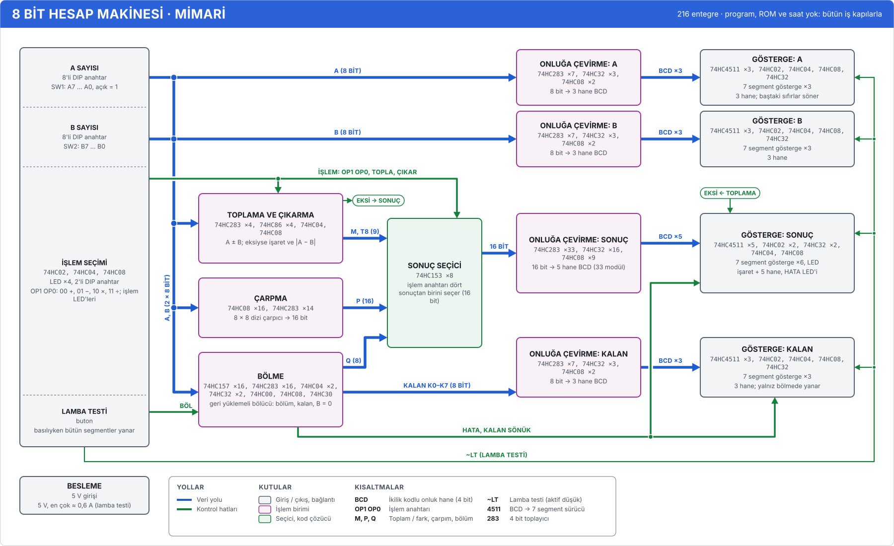

# Mimari (blok) diyagramları

Üç blok diyagramı var: CPU16 işlemci kartı, bütün CPU16 bilgisayarı (yedi kart, arka panel ve dış
cihazlar) ve 8 bit hesap makinesi. Her kutu kartın bir işlev bloğudur: adı, tek satırlık görevi ve
içindeki entegreler. Kutulardaki parça listeleri ve sayılar elle yazılmaz, devreden (`cpu16/board/`,
`hesap8/kart.ts`) sayılır. Çizgiler kutular arasındaki yollardır ve her biri gerçek netlere bağlıdır.
Devre değişip bir bağlantı koparsa ya da okun yönü pinlere uymazsa testler düşer.

Diyagramları üç yerde görebilirsin:

- **Uygulamada**, Silikon3D → **Mimari** bölümünde (`#mimari`, `#mimari/cpu`, `#mimari/makine`,
  `#mimari/hesap`). Kaydırıp yakınlaştırabilir, bir kutunun yollarını öne çıkarabilir ve kutunun
  entegrelerini görebilirsin. "3D'de göster" seni o bloğa götürür.
- **Bu belgede**, aşağıdaki SVG'ler. Kaynakları `cpu16/docs/img/` ve `hesap8/docs/img/` altında,
  `npm run cpu16 -- mimari` üretir.
- **Kurulum belgelerinde**: breadboard dizin belgesinin (`npm run cpu16 -- breadboard-belge hepsi`) ve
  hesap makinesinin breadboard belgesinin (`npm run hesap8 -- breadboard-belge`) kapağından sonra,
  A4 yatay birer "Mimari" sayfası.

## CPU16 işlemci kartı


Tek bir 16 bitlik iç veri yolu (BUS0–BUS15) var. Her saat döngüsünde kontrol birimi bir sürücü seçer
(`~SRC_*` hatları); kontrol kelimesinin yükleme bitleri de hangi register'ların yoldan yükleneceğini
söyler. Bir komut birkaç döngüde yürür: getir (PC → MAR, bellek → IR), çöz, çalıştır. Ayrıntısı
[mikromimari.md](mikromimari.md)'de.

| Kutu | Görevi |
|---|---|
| Register dosyası (R0–R7) | 8 × 16 bit register; hangisinin okunup yazılacağını RSEL ve IR'deki alanlar seçer |
| Geçici register'lar | TA ve TB: ALU'nun iki girişi. Yoldan yüklenir, ALU'ya ayrı hatlarla (TA, TB) gider |
| ALU | Üstte işlem kodundan 24 denetim biti çıkaran kod çözücü, altta toplayıcılar (4 × 74HC283), mantık ve kaydırma. Sonucu iç veri yoluna sürer |
| Bayraklar ve koşul | N Z C V ve I bayrakları. ALU'nun sonuç bitlerinden yüklenir, dallanma koşulunu (COND) kontrol birimine verir; elde biti (C) ALU'ya geri döner |
| Program sayacı (PC) | Sıradaki komutun adresi: += 2 ya da yoldan yüklenir (dallanma, çağrı) |
| Sabit birimi | Komuttaki sabiti ya da ofseti (IR'nin alt bitleri) işaretiyle 16 bite genişletip yola sürer |
| MAR ve IR | IR çalışan komutu tutar ve kontrol birimine ve sabit birimine verir. MAR erişilecek adresi tutar ve arka paneldeki adres yolunu (A0–A15) doğrudan sürer |
| Bellek arayüzü | 16 bitlik iç veri yolunu arka paneldeki iki bayt hattına (DE çift, DO tek adresli) bağlar; okuma ve yazma darbelerini (~MRD, ~MWE_E, ~MWE_O) üretir |
| Kontrol | Solda mikrokod: komut, adım ve koşuldan 32 kontrol hattı. ROM yok, 74HC138 / 151 ve kapılarla kurulu. Sağda kontrol register'ı (CR), adım sayacı, kesme ve HALT |
| Arka panel | J1, 2 × 32 konnektör: öbür kartlara giden bütün hatlar |
| Yapıştırıcı lojik | 74HC00 / 08 / 32 … çipleri. Kapıları farklı bloklara dağılmıştır; her kutu kendi kapı sayısını "+ N kapı (yapıştırıcı lojikte)" diye yazar |

| Yol | Netler | Nereden → nereye |
|---|---|---|
| İç veri yolu (16 bit) | BUS0–BUS15 | sürücüler: register dosyası, ALU, bayraklar, PC, sabit birimi, bellek arayüzü; okuyanlar: hepsi ve TA / TB, IR / MAR |
| TA, TB (16 bit) | TA0–TA15, TB0–TB15 | geçici register'lar → ALU |
| N Z C V, C | RES15, Z_ALU, C_ALU, V_ALU; ~CFLAG | ALU → bayraklar; elde bayrağı → ALU |
| IR, Komut (IR) | IR0–IR11, IR0–IR15 | IR → sabit birimi, IR → kontrol birimi |
| Kontrol hatları | CW0–CW31, ~SRC_* | kontrol birimi → bütün birimler |
| Koşul, I | COND, IFLAG | bayraklar → kontrol birimi |
| Adres yolu (16 bit) | A0–A15 | MAR → arka panel (bellek arayüzü A0'ı bayt seçimi için okur) |
| Veri (16 bit) | DE0–DE7, DO0–DO7 | bellek arayüzü ↔ arka panel |
| ~MRD ~MWE, WR_WIN | ~MRD, ~MWE_E, ~MWE_O; WR_WIN | bellek arayüzü → arka panel; yazma penceresi saat kartından |
| CLK, ~RESET; IRQ; HALTED, FAULT | | arka panel → kontrol birimi; kontrol birimi → arka panel (LED'ler) |

## Bütün bilgisayar


Yedi kart aynı 64 hatlı arka panele takılır ([anakart-kartlari.md](anakart-kartlari.md),
[anakart-gc-video.md](anakart-gc-video.md)). Diyagramın ortasındaki bant arka paneldir: her şerit bir
hat grubu, her kartın kolu kullandığı şeride iner. Kart çerçevelerinin içinde kartın blokları var.
Başlıktaki sayı kartın bütün entegrelerini ("194 entegre") ve bunların kaçının kapı çipi
(yapıştırıcı lojik) olduğunu gösterir. CPU kartının içi ayrıntılı olarak yukarıdaki diyagramda;
uygulamada "ayrıntı ›" ya da çift tıklama oraya geçer.

| Şerit | Hatlar | Süren → okuyanlar |
|---|---|---|
| Bank adresi | PA14–PA19 | bellek kartının bank register'ları → önbellek (etiketinde tutar) |
| Bekleme | ~WAIT | önbellek (ıskalamada) → saat kartı, bellek kartı |
| Saat ve reset | CLK, WR_WIN, TCLK, OSC, ~RESET | saat kartı → bütün kartlar |
| Adres yolu | A0–A15 | CPU (MAR) → bellek, önbellek, G/Ç, video, kendin yap bellek |
| Veri yolu | DE0–DE7, DO0–DO7 | iki yönlü: CPU yazarken, seçilen kart okurken sürer |
| Bellek denetimi | ~MRD, ~MWE_E, ~MWE_O | CPU → bellek ve G/Ç kartları |
| G/Ç alanı | ~IO | bellek kartının adres çözücüsü (FFxx) → G/Ç kartları |
| Kesme | IRQ, VSYNC_REQ | video (kare sonu) → G/Ç kartının kesme denetleyicisi → CPU |

Dış bağlantılar kesik çizgili kutulara gider: USB-seri (bilgisayar), PS/2 klavye ve VGA monitör.
Kartlarda yalnız arka panele ya da dışarıya bağlanan bloklar yollarla çizilidir; kart içi
bağlantılar (ör. video kartında VRAM → piksel yolu) bu diyagramda yok, kartların kendi belgelerinde
var.

## 8 bit hesap makinesi



Saat, program ve ROM yok. Anahtarlardaki A ve B sayıları dört işlem birimine birden gider; işlem
anahtarı sonuç seçicide birini seçer. Sonuç, A, B ve kalan ikiliden onluğa çevrilip 7 segment
göstergelere gider. Blokların anlatımı: [hesap8/docs/tasarim.md](../../hesap8/docs/tasarim.md#bloklar).

## Nasıl okunur

- **Kutunun rengi türünü gösterir.** Kehribar: register, sayaç. Eflatun: işlem birimi. Yeşil: seçici,
  kod çözücü. Mavi: tampon, alıcı-verici. Camgöbeği: bellek. Mor: kontrol, zamanlama. Kurşuni: giriş /
  çıkış, bağlantı. Kesik çizgili kutular ya dış cihazdır ya da nottur.
- **Kutunun içinde** önce ad, sonra entegreler ("74HC574 ×16": o tipten 16 tane), anahtar, gösterge,
  konnektör gibi parçalar, yapıştırıcı lojikteki kapıları ("+ 8 kapı") ve en altta görevi yazar.
  Bölmeli kutularda (ALU, MAR ve IR, kontrol) her bölmenin kendi listesi vardır.
- **Yol renkleri:** mavi veri, kiremit adres, yeşil kontrol, mor saat ve reset, kurşuni kart içi
  yerel bağlantı, camgöbeği dış bağlantı. Kırmızı kullanılmaz; uygulamada kırmızı yalnız hata ve
  lojik 1 içindir.
- **Kalınlık bit sayısını gösterir:** 8 ve üstü bit kalın, 2–7 bit orta, tek hat ince. Etiketteki
  "(16 BİT)" net sayısıdır ve testte denetlenir.
- **Ok yönü:** ok, yolu süren kutudan okuyan kutuya gider. İki uçlu ok iki yönlü bağlantıdır (veri
  yolu gibi). Gövdeye bağlanan bir kolun ucundaki ok, o kutunun yolu sürdüğünü gösterir.
- **Nokta** dallanmadır: aynı yolun iki çizgisi orada birleşir. Birleşmeden kesişen yollarda üstten
  geçen çizgi, alttakinde küçük bir aralık açar.
- **Etiketli uç** (yuvarlak köşeli küçük kutu, ör. "KOŞUL, I → KONTROL") sayfa içi bağlayıcıdır:
  çizgi orada biter, aynı adlı ucun yanında devam eder.

## Doğruluk: neler denetleniyor

Diyagramlar elle yerleştirilir (kutuların yeri, çizgilerin kıvrımları) ama içerikleri devreden gelir.
`cpu16/tests/mimari.test.ts` ve `hesap8/tests/mimari.test.ts` her diyagram için şunları denetler
(`cpu16/mimari/denetim.ts`):

1. **Bloklar:** diyagramın kapsadığı kartların her bloğu (`ChipInstance.block`) tam bir kutuda ya da
   kart çerçevesinde durur; tanımdaki her blok devrede vardır. Bölmeli kutularda her parça tam bir
   bölmeye düşer.
2. **Yollar:** her net devrede vardır. Yolun her ucu, netlerinden en az birine pinle bağlıdır. Ok
   yönü pinlere uyar: "çıkış" kutusu netlerden birini sürer, "giriş" kutusu okur ama sürmez, "iki
   yönlü" ikisini de yapar. Dış cihaz uçlarının karşısında o netlere bağlı bir konnektör vardır.
   Etiketteki bit sayısı net sayısına eşittir. Makinede arka panel şeritlerinin her kartla bağlantısı
   ayrıca denetlenir: kart kullandığı her şeride bir kolla bağlıdır, kullanmadığına bağlı değildir.
3. **Sayılar:** kutuda yazan parça listesi ve adetleri, "+ N kapı" satırı ve çerçeve başlığındaki
   entegre sayısı, Board'dan bağımsız olarak yeniden sayılanla aynıdır.
4. **Yerleşim:** yazılar kutulara sığar (yazı tipi genişlik tablosuyla, %5 payla) ve her çizginin ucu
   bir kutuda, gövdede ya da bağlayıcıdadır.
5. **Bağlantılar:** uygulamadaki vurgu ve yan panel için kurulan ilişki (`cpu16/mimari/iliski.ts`)
   her yolun uçlarını içerir. Makinede bir kart ucunun içinde yolun netlerine gerçekten değen bir
   kutu vardır ve yönü pinlerden çıkar (ör. adres yolunu CPU kartında MAR'lı register kutusu sürer).
6. **Belgeler:** depodaki SVG'ler devreyle günceldir. Devre ya da tema renkleri değişince test
   `npm run cpu16 -- mimari` çalıştırmanı ister.

Renklerin karşıtlığı `npm run kontrast` ile ölçülür. İki temada da yol renkleri kâğıtta en az 4,5:1
yazı karşıtlığındadır, kutu çizgileri en az 3:1'dir, kutu zeminlerindeki yazılar en az 4,5:1'dir.

## Uygulamada: Mimari bölümü

| | |
|---|---|
| Diyagram seçimi | araç çubuğundan ya da 1, 2, 3 tuşlarıyla. Adres `#mimari/<cpu\|makine\|hesap>` |
| Kaydırma, yakınlaştırma | sürükle; tekerlek imlecin olduğu yere yakınlaştırır; dokunmatikte iki parmak; + / − ve 0 (sığdır) |
| Üstüne gelince | kutunun kendisi, yolları ve yollarının öbür uçları öne çıkar, gerisi soluklaşır. Yolun üstüne gelince yolun bütün uçları öne çıkar (makinede kartların içinde o netlere değen kutular da) |
| Tıklayınca | yan panelde: görevi, açıklaması, bölmelere ya da bloklara göre entegreler (ref, parça, görev), yapıştırıcı lojikteki kapıları ve bağlı olduğu yollar. Bir yol seçilince netleri ve her uçta o netlere pinleri bağlı entegreler görünür |
| 3D'de göster | 3D bölümüne (bilgisayar `#kart`, hesap makinesi `#hesap`) geçer, bloğun ilk entegresini seçer; kamera ona uçar |
| Klavye | Tab kutular arasında gezer (kutu görünüme kayar), Enter seçer, Esc seçimi kaldırır, sahne odaktayken oklar kaydırır |

Bölüm kendi parçasında yüklenir: diyagramlar ve devre modelleri gelir, three.js ve 3D kodu gelmez.
Çizim kütüphanesiz, elle yazılmış SVG'dir. Uygulama ve belgeler aynı öğe ağacını çizer; uygulamada
renkler temanın belirteçleridir (`src/mimari/mimari.css`), belgede açık temanın düz renkleri.

## Üretmek

```sh
npm run cpu16 -- mimari                    # belgelerdeki üç SVG'yi yenile (cpu16/docs/img/, hesap8/docs/img/)
npm run cpu16 -- mimari makine -o out      # yalnız bütün bilgisayar, out/mimari-makine.svg
npm run cpu16 -- mimari hepsi -o out --koyu   # koyu temada (dosya adı -koyu ile biter)
```

Diyagram devreye uymuyorsa komut dosyayı yazmaz ve neyin uymadığını söyler.

## Dosyalar

| Dosya | İçerik |
|---|---|
| `cpu16/mimari/model.ts` | Tanım türleri (kutu, bölme, çerçeve, yol, lejant), devre çözümlemesi (`Devre`: bloklar, parçalar, netlerin uçları), sayım |
| `cpu16/mimari/cpu.ts`, `makine.ts`, `hesap8/mimari.ts` | Üç diyagramın yerleşimi: kutuların yeri ve blokları, yolların netleri, uçları ve çizgileri |
| `cpu16/mimari/cizim.ts` | Sahne: kutu içeriği (parça satırları, sığdırma), oklar, dallanma ve kesişme noktaları, bağlayıcılar, lejant |
| `cpu16/mimari/agac.ts` | Sahneden SVG öğe ağacı; düz SVG metni ve stil |
| `cpu16/mimari/denetim.ts`, `iliski.ts` | Netlist denetimleri; kutu, çerçeve ve yol ilişkileri |
| `cpu16/mimari/index.ts` | Diyagram listesi, kurulum (devreler bir kez kurulur) |
| `cpu16/mimari/palet.ts`, `belge.ts`, `cli.ts` | Belge paleti (CSS'ten), belge sayfası, `npm run cpu16 -- mimari` |
| `src/mimari/` | Uygulamanın Mimari bölümü: sahne (kaydırma, vurgu), yan panel, 3D'ye geçiş (`bolumuGoster.ts`) |

**Yeni bir kutu ya da yol eklemek:** kartta yeni bir blok açıldıysa (`board.block = "…"`) blok
denetimi o bloğun hiçbir kutuda olmadığını söyler. Bloğu uygun kutunun `bloklar` listesine ekle ya da
yeni bir kutu aç (ızgaraya hizalı yer, `rol`, tek satırlık `gorev`, yan panel için `aciklama`). Yeni
bir yolun `netler`i devredeki adlarıyla yazılır, `uclar` kutu kimlikleri ve yönleriyle. `kollar`
kutunun kenarından başlar; öbür ucu kutuda, gövdede ya da başka bir kolda biter. Testler yerleşim
hatasını (sığmayan yazı, boşta kalan uç) ve yön uyuşmazlığını adıyla söyler.
