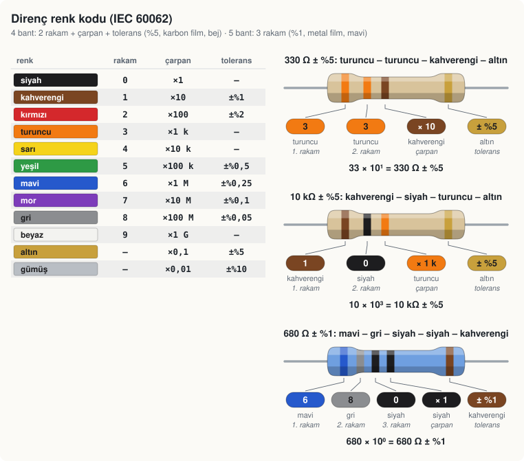
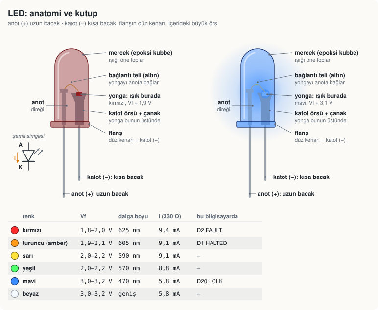
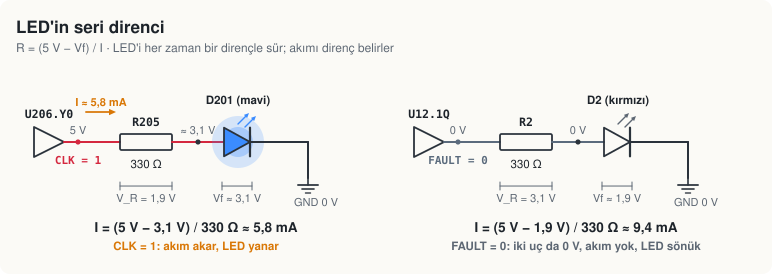
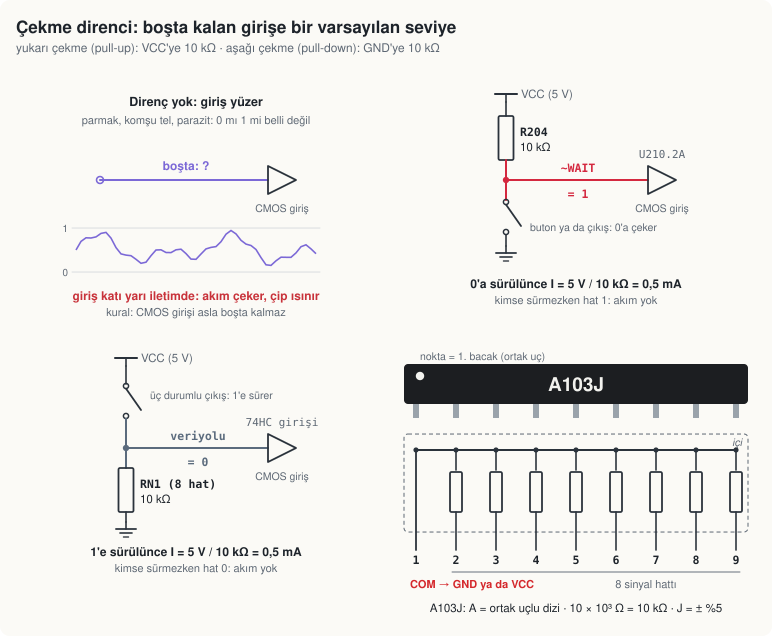
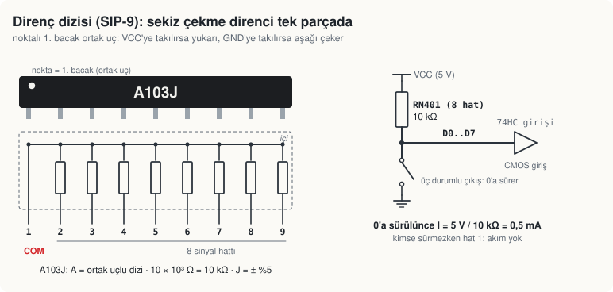
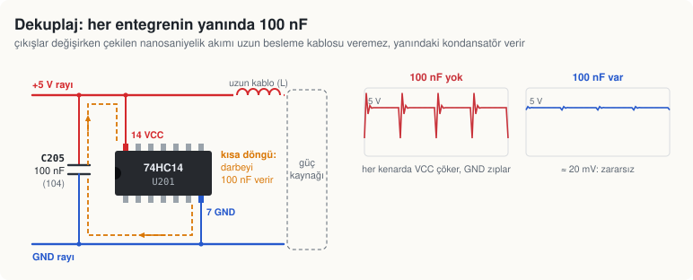
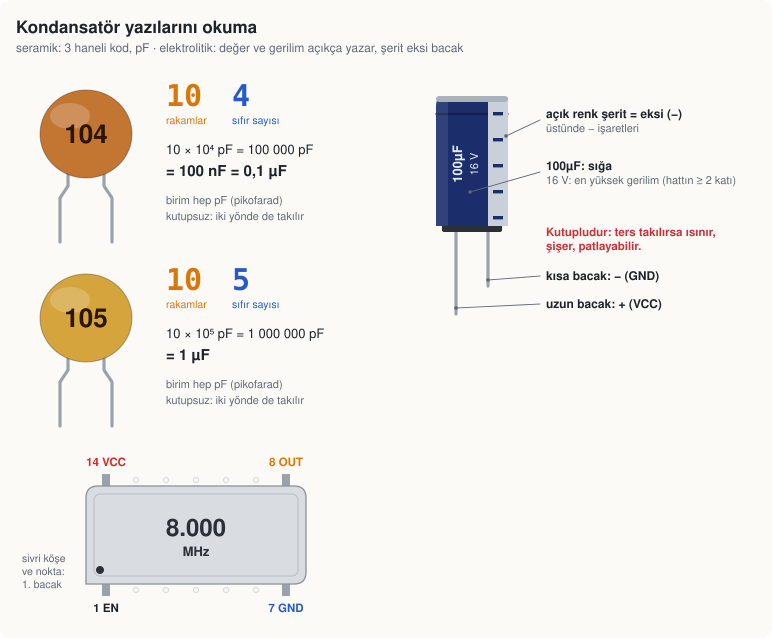
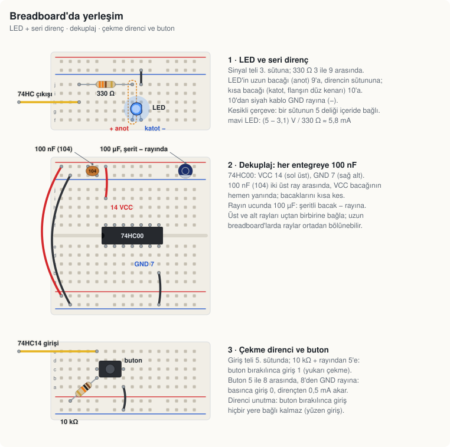

# LED, direnç ve kondansatör: kitin pasif elemanları

> **Ne zaman:** Deney 1'den önce bir kez oku, takarken yanında dursun. · **Kart:** hepsi ·
> **3D:** Silikon3D → "CPU16 kartı 3D", bir pasife tıkla: sağ panelde bu sayfanın o elemana ait kısmı canlı değerlerle açılır.

Bilgisayar ≈ 400 entegreden oluşur, ama her kartta entegrelerin yanında küçük parçalar da vardır:
dirençler, direnç dizileri, kondansatörler, LED'ler, butonlar, osilatörler. Hepsi ucuzdur ve hepsi
yanlış takılabilir. Bu sayfa her birinin üstündeki yazıyı okumayı, doğru yönde takmayı ve bu
bilgisayarda ne iş yaptığını anlatır.

Görseller `cpu16/kit/gorseller/` klasöründedir ve şemadan üretilir (`npm run cpu16 -- kit`): şemada
bir LED'in direnci ya da sürücüsü değişirse çizim de değişir.

## Kitteki pasifler

| Eleman | Değer | Nerede | Takarken |
|---|---|---|---|
| Direnç, karbon film (bej) | 330 Ω | LED'lerin seri direnci (R1, R2, R205) | yönü yok |
| Direnç, karbon film | 10 kΩ | çekme dirençleri, reset ve buton RC'si (R201, R202, R204, R601–R603) | yönü yok |
| Direnç, karbon film | 1 kΩ | yavaş osilatörün en küçük direnci (R203) | yönü yok |
| Direnç, metal film (mavi), %1 | 680 Ω, 1,3 kΩ | VGA renk DAC'ı (R701–R706) | yönü yok |
| Direnç dizisi SIP-9 | 8 × 10 kΩ, "A103J" | veriyolu çekme dirençleri (RN1, RN2, RN401–RN403) | **noktalı uç ortak hatta** |
| Seramik disk kondansatör | 100 nF, "104" | her entegrenin dekuplajı (ör. U201'in yanında C205) | yönü yok |
| Seramik kondansatör | 1 µF, "105" | buton süzgeci, yavaş osilatör (C202, C203) | yönü yok |
| Elektrolitik kondansatör | 10 µF, 100 µF | reset gecikmesi (C201), kart besleme girişi (C204) | **şerit = eksi** |
| LED, 3 mm | turuncu, kırmızı, mavi | HALTED (D1), FAULT (D2), CLK (D201) | **uzun bacak = artı** |
| Trimpot | 100 kΩ, "104" | yavaş saat hızı (RV201) | orta uç silecek |
| Kristal osilatör | 8 MHz, 25,175 MHz | CPU saati (X201), VGA piksel saati (X701) | **sivri köşe = 1. bacak** |

## Direnç ve renk kodu



Direnci altın (ya da gümüş) bandı **sağda** kalacak şekilde tut ve soldan oku:

- **4 bant** (karbon film, bej gövde, ± %5): iki rakam, çarpan, tolerans.
  330 Ω = **turuncu** (3) **turuncu** (3) **kahverengi** (× 10) **altın** (± %5): 33 × 10 = 330.
- **5 bant** (metal film, çoğunlukla mavi gövde, ± %1): üç rakam, çarpan, tolerans.
  680 Ω = **mavi** (6) **gri** (8) **siyah** (0) **siyah** (× 1) **kahverengi** (± %1).

Bu bilgisayardaki değerler:

| Değer | Bantlar | Nerede |
|---|---|---|
| 330 Ω ± %5 | turuncu – turuncu – kahverengi – altın | LED seri direnci |
| 1 kΩ ± %5 | kahverengi – siyah – kırmızı – altın | yavaş osilatör |
| 10 kΩ ± %5 | kahverengi – siyah – turuncu – altın | çekme dirençleri, RC |
| 680 Ω ± %1 | mavi – gri – siyah – siyah – kahverengi | VGA DAC renk biti |
| 1,3 kΩ ± %1 | kahverengi – turuncu – siyah – kahverengi – kahverengi | VGA DAC parlaklık biti |

Emin değilsen multimetreyle ölç: direnci devreye takmadan, iki ucundan. Kahverengi ile kırmızı,
turuncu ile kırmızı loş ışıkta karışır; 330 Ω yerine 3,3 kΩ takarsan LED zor görünür, 10 kΩ yerine
1 kΩ takarsan çekme direnci gereksiz akım çeker.

## LED: anatomi ve kutup



LED bir diyottur: akım yalnız **anottan katoda** akar; ters takılırsa yanmaz (5 V'luk devrede genellikle zarar da görmez, çevirip tekrar tak).
Kutbu dört yoldan bulursun:

1. **Uzun bacak anottur (+).** Bacaklar kesildiyse işe yaramaz.
2. **Flanşın düz kenarı katottur (−).** Gövdenin dibindeki halkanın bir yanı düzdür.
3. **İçerideki büyük parça (örs, çanak) katottur.** Işığa tutunca görünür; yonga onun üstündedir.
4. **Multimetrenin diyot kipi:** kırmızı prob anotta, siyah katottayken LED hafifçe yanar ve ekranda
   ileri gerilim (Vf) görünür.

### Bu bilgisayarın LED renkleri

Renk LED'in görevinden seçilir (`cpu16/board/passives.ts`, `LED_RENK_KURALLARI`); 3D görünüm, panel
ve bu sayfa aynı kuralı kullanır.

| LED | Görev | Renk | Neden | Vf |
|---|---|---|---|---|
| D2 | FAULT: CPU yasadışı (tanımsız) bir komutta durdu | kırmızı | hata: en çok dikkat çeken renk | ≈ 1,9 V |
| D1 | HALTED: CPU HALT komutuyla durdu | turuncu (amber) | uyarı, ama hata değil | ≈ 2,0 V |
| D201 | CLK: CPU saati | mavi | durmadan yanıp söner, öteki durum LED'lerinden ayrı dursun | ≈ 3,1 V |
| — | besleme / "her şey yolunda" göstergesi eklersen | yeşil | trafik lambası mantığı | ≈ 2,1 V |
| — | veri ya da adres hattı izlersen | sarı | izleme LED'leri, durum LED'lerinden ayrı | ≈ 2,0 V |

Kural bu sırayla uygulanır; görevi hiçbirine uymayan LED kırmızıdır.

## Seri direnç: LED'i her zaman bir dirençle sür



LED'in ileri gerilimi (Vf) aşılınca akımı neredeyse yalnız devredeki direnç belirler. Direnç
olmazsa 74HC çıkışı ile LED, çıkış transistörünün kaldırabileceğinden çok akım çeker: çıkış
gerilimi çöker, çip ısınır, LED ölebilir. Hesap dört adımdır:

1. Dirençteki gerilim: V_R = 5 V − Vf.
2. İstenen akım için direnç: R = V_R / I. 3 mm LED'e 5–10 mA yeterince parlaktır (en çok 20 mA).
3. Bir üst standart değeri seç (E12: … 220, 270, **330**, 390, 470 …).
4. Dirençteki güç: P = I² · R. ¼ W'lık direnç için birkaç mW hiçtir.

Örnek, CLK LED'i (D201, mavi, Vf ≈ 3,1 V, R205 = 330 Ω):

```
V_R = 5 V − 3,1 V = 1,9 V
I   = 1,9 V / 330 Ω ≈ 5,8 mA
P   = (5,8 mA)² · 330 Ω ≈ 11 mW
```

Aynı 330 Ω kırmızı LED'de (D2, Vf ≈ 1,9 V) ≈ 9,4 mA verir. Mavi biraz daha az akım alır ama mavi
LED'ler zaten parlaktır; parlaklıkları göz kararı eşittir. 74HC çıkışı bu akımda 0,2–0,4 V düşer,
gerçek akım hesaptakinden biraz azdır. Bir 74HC çıkışından en çok ± 25 mA çekilir.

**LED'i veriyoluna doğrudan bağlama:** her LED hattı ≈ 6–9 mA yükler; 10 kΩ çekme direnciyle
tutulan ya da birkaç girişi süren bir hat 1 sayılmayabilir. Veriyolunu izlemek için gösterge
modülünü (74HC541 + LED + direnç, bkz. [README](README.md)) kullan.

## Çekme dirençleri (pull-up, pull-down)



Bir CMOS girişi hiçbir yere bağlı değilse (**yüzen giriş**) seviyesi belirsizdir: parmağın, komşu
tel, parazit onu 0 ile 1 arasında gezdirir. Giriş katının iki transistörü birden yarı iletimde
kalır, çip akım çeker ve ısınır (Deney 2'nin 5. adımında bunu kendin görürsün).

Çekme direnci girişe bir **varsayılan seviye** verir:

- **Yukarı çekme (pull-up):** VCC'ye 10 kΩ. Kimse sürmezken hat 1'dir. Bir buton ya da çıkış hattı
  0'a çekince dirençten 5 V / 10 kΩ = 0,5 mA akar; 10 kΩ çıkışın birkaç on ohm'luk iç direncine göre
  çok büyük olduğu için çıkış hattı rahatça 0 yapar.
- **Aşağı çekme (pull-down):** GND'ye 10 kΩ. Kimse sürmezken hat 0'dır.

Bu bilgisayarda:

| Direnç | Hat | Yön | Neden |
|---|---|---|---|
| R204 | `~WAIT` | yukarı | bekleme isteyen kart takılı değilse CPU beklemez |
| R202 | `STEP_RC` | yukarı | ADIM butonu (SW202) bırakılınca 1; basınca GND |
| R601 | `UART_RXD` | yukarı | USB-UART modülü takılı değilken alıcı rastgele bayt almasın |
| R602, R603 | `PS2_CLK`, `PS2_DAT` | yukarı | PS/2 hatları açık kollektördür: iki taraf da yalnız 0'a çeker |
| RN401–RN403 | bellek veri yolu, `DE`, `DO` | yukarı | boş adres bölgesi 0xFF okunur |
| RN1, RN2 | CPU iç veriyolu | aşağı | hiçbir register sürmezken veriyolu 0 |

**Neden 10 kΩ?** Daha küçüğü (1 kΩ) hat 0'a sürülünce 5 mA boşa akıtır ve sürücüyü zorlar. Daha
büyüğü (1 MΩ) hattın kapasitesini (≈ 20 pF) yavaş doldurur: τ = R · C = 20 µs, 1'e dönüş geç kalır
ve parazit kolay bulaşır. 10 kΩ ile τ = 0,2 µs, akım 0,5 mA: ikisi de makul.

## Direnç dizisi (SIP-9)



Sekiz çekme direnci tek parçada. İçeride sekiz direncin bir ucu **noktalı 1. bacağa** (ortak uç,
COM) bağlı bir baraya, öbür uçları 2–9. bacaklara çıkar. Ortak uç VCC'ye takılırsa sekiz hat
yukarı, GND'ye takılırsa aşağı çekilir.

Üstündeki **A103J**: A = ortak uçlu (bussed) dizi, 103 = 10 × 10³ Ω = 10 kΩ, J = ± %5. Ters takılırsa
(nokta sağda) ortak uç bir sinyal hattına, bir sinyal bacağı beslemeye gider: o hat kalıcı olarak
1 ya da 0 olur. Takmadan önce noktayı ve şemadaki COM netini kontrol et.

## Dekuplaj: her entegrenin yanında 100 nF



Bir 74HC çıkışı değişirken nanosaniyeler içinde yük kapasitesini doldurur. Sekiz çıkış aynı anda
değişince çekilen yük Q = 8 × 50 pF × 5 V = 2 nC'dir. Bu akım uzun besleme kablosundan gelirse
kablonun endüktansı (10 cm ≈ 100 nH) V = L · di/dt = 100 nH × 0,3 A / 5 ns ≈ 6 V'luk bir sıçrama
yapar: VCC çöker, GND zıplar, flip-floplar yanlış tetiklenir. Çipin hemen yanındaki 100 nF aynı
yükü ΔV = 2 nC / 100 nF ≈ 20 mV'luk zararsız bir düşüşle verir.

Kurallar:

- **Her entegreye bir 100 nF**, VCC ve GND bacaklarına olabildiğince yakın, bacakları kısa.
  Tam bilgisayarda yüzlercesi vardır; 3D görünümde her çipin yanında turuncu bir disk olarak durur.
- **Her kartın (her breadboard'un) besleme rayına bir 100 µF** elektrolitik (ör. saat kartında
  C204): yavaş değişimleri ve kablonun düşümünü karşılar.
- Davranış saat hızlanınca bozuluyorsa ilk bakılacak yer dekuplajdır.

74HC entegrelerinde VCC hep en büyük numaralı bacaktır (14 bacakta 14, 16'da 16, 20'de 20), GND
onun karşısındaki köşe (7, 8, 10). 28 bacaklı bellekler (62256, 28C256) de aynıdır: VCC 28, GND 14.

## Kondansatör yazılarını okuma



**Seramik:** üç haneli kod, birim **pF**: iki rakam ve arkasına eklenecek sıfır sayısı.

| Kod | Okunuş | Değer | Bu bilgisayarda |
|---|---|---|---|
| 104 | 10 × 10⁴ pF | 100 nF = 0,1 µF | dekuplaj |
| 105 | 10 × 10⁵ pF | 1 µF | buton süzgeci (C202), yavaş osilatör (C203) |
| 103 | 10 × 10³ pF | 10 nF | — |
| 102 | 10 × 10² pF | 1 nF | — |
| 220 | 22 × 10⁰ pF | 22 pF | — |

Seramiklerin yönü yoktur. Trimpotun üstündeki kod da aynı kuraldır ama birimi ohm'dur:
RV201'deki 104 = 100 kΩ.

**Elektrolitik:** değer ve gerilim açıkça yazar ("100µF 16V"). **Kutupludur:** gövdedeki açık renk
şerit (üstünde − işaretleri) eksi bacağı gösterir, uzun bacak artıdır. Ters takılırsa ısınır, şişer,
patlayabilir. Gerilim değeri hattın en az iki katı olmalı: 5 V için 10 V ya da 16 V.

**RC devreleri:** C201 (10 µF) R201 (10 kΩ) üzerinden dolar: τ = R · C = 0,1 s, açılış reseti bu kadar
sürer. C202 (1 µF) ADIM butonunun sıçramasını süzer. C203 (1 µF), R203 (1 kΩ) ve RV201 (0–100 kΩ)
yavaş osilatörün frekansını belirler: f ≈ 1 / (R · C) ≈ 10 Hz … 1 kHz.

**Osilatör:** DIP-14 boyutunda metal kutu, yalnız 4 bacağı vardır. Sivri köşe ve nokta 1. bacaktır:
1 EN (boşta ya da 1 = çalışır), 7 GND, 8 çıkış, 14 VCC. X201 ilk kurulumda 8 MHz'dir (CPU 1 MHz).

## Breadboard'da yerleşim



Breadboard'un ortadaki kanalın iki yanında **dikey beşli sütunlar** içeride bağlıdır; kenardaki
uzun raylar (+ ve −) yatay bağlıdır. Bir elemanın iki bacağı aynı sütuna takılırsa kısa devre olur.

1. **LED + seri direnç:** sinyal teli bir sütuna, direnç o sütundan boş bir sütuna, LED'in uzun
   bacağı direncin sütununa, kısa bacağı başka bir sütuna ve oradan GND rayına.
2. **Dekuplaj:** entegre ortadaki kanalın üstünde; 100 nF iki besleme rayı arasında, VCC bacağının
   hemen yanında. Rayın ucunda 100 µF, şeritli bacak − rayına. Üst ve alt rayları uçlardan
   birbirine bağla.
3. **Çekme direnci + buton:** giriş teli bir sütuna, 10 kΩ + rayından o sütuna, buton o sütundan
   GND rayına giden bir sütuna. Bırakınca giriş 1, basınca 0.

## 3D görünümde

Silikon3D → "CPU16 kartı 3D":

- **Bir pasife tıkla:** sağ panelde değerin okunuşu (renk bantları, "104", "A103J"), çizimi, bu
  karttaki görevi, hesapları (LED akımı, çekme akımı, τ) ve bacaklarının canlı seviyesi açılır.
  İlgili elemanlara (LED'in direnci, dekuplaj kondansatörünün çipi) tıklayıp geçebilirsin.
- **Üstüne gel:** ipucunda tek satır özet, ör. "mavi LED · CLK · ≈ 5,8 mA · yanıyor".
- **LED'ler canlıdır:** sürdükleri sinyal 1 olunca parlar, halesi ve karttaki ışık lekesi görünür.
  `kart.yakinlas("D201")` kamerayı CLK LED'ine yaklaştırır; `kart.hiz(2)` ile saati yavaşlatıp
  yanıp sönmesini izle.
- **Lehim noktaları seviyenin rengindedir** (kırmızı 1, gri 0, mor Z). Simülasyon dirençlerin
  değerini bilmez: yalnız pasiflere bağlı bir net (ör. LED'in anodu, `LED_CLK`) direncin öbür
  ucundaki sinyalin rengini alır.
- Sürgülü anahtarların (SW203, SW204) sürgüsü konumlarını canlı gösterir.

## Sorun giderme

| Belirti | Bak |
|---|---|
| LED hiç yanmıyor | ters takılmış (uzun bacak sinyal tarafında mı), direnç yanlış sütunda, sinyal hep 0 |
| LED çok sönük | direnç çok büyük (3,3 kΩ: turuncu – turuncu – **kırmızı**), sürücü yüklü |
| LED yanıyor ama entegre ısınıyor | seri direnç yok ya da kısa devre edilmiş |
| Davranış dokunmayla değişiyor | çekme direnci eksik (yüzen giriş), SIP dizisi ters takılmış |
| Bir veri hattı hep 1 ya da hep 0 | SIP dizisinin noktası yanlış uçta: ortak uç bir sinyal hattında |
| Saat hızlanınca bozuluyor | dekuplaj eksik, 100 nF'lar çipten uzak, rayların ucunda 100 µF yok |
| Elektrolitik ısınıyor ya da şişti | ters takılmış: şerit GND tarafında olmalı |
| Reset hiç bitmiyor ya da hiç olmuyor | C201 ters, R201 yanlış değer (10 kΩ = kahverengi – siyah – turuncu) |
