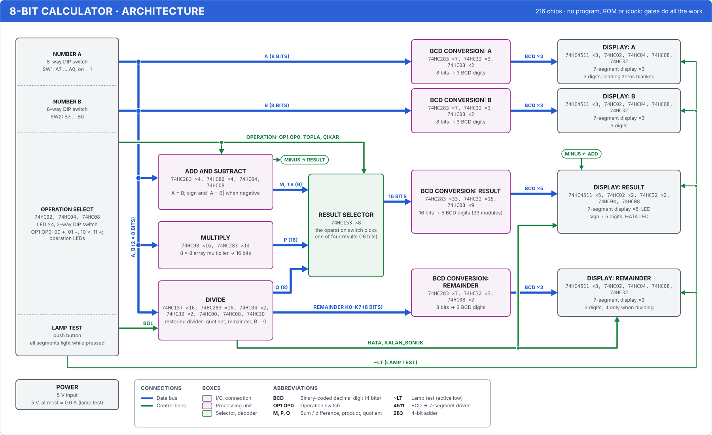

# 8-bit calculator: design

Two 8-bit numbers (A and B, 0–255) are entered on DIP switches, and a 2-way DIP switch selects the
operation: addition, subtraction, multiplication, division. The numbers and the result appear on
decimal seven-segment displays. There is no program, microcontroller, ROM or clock: all the work happens
in common 74HC chips, in a purely **combinational** circuit. When you flip a switch, the result reaches
the display after nothing more than the gate delays (worst case ≈ 2 µs).

Schematic = code: the circuit is defined in `hesap8/kart.ts`. The gate-level simulation, the 3D view
(Silikon3D → "8-bit calculator 3D"), the KiCad schematic (`cpu16/kicad/hesap/`), the BOM and the build
guide are generated from the same definition. All 4 × 256 × 256 = 262,144 cases have been tested at
gate level and match the golden model (`hesap8/model.ts`): `npm run hesap8 -- dogrula --hepsi`.

## Usage

| Switch | Function |
|---|---|
| SW1 (8-way) | The A number. A7 … A0 from left to right; switch on = 1 |
| SW2 (8-way) | The B number, same layout |
| SW3 (2-way) | Operation: switch 1 is OP1, switch 2 is OP0 |
| SW4 (button) | Lamp test: while pressed, 14 digits show "8" and the sign digit shows "−" (all segments lit) |

| OP1 OP0 | Operation | Result display | Remainder display |
|---|---|---|---|
| 0 0 | A + B | 0 … 510 | off |
| 0 1 | A − B | −255 … 255 (a "−" in the sign digit when negative) | off |
| 1 0 | A × B | 0 … 65,025 | off |
| 1 1 | A ÷ B | quotient 0 … 255 | remainder 0 … 254; if B = 0 the HATA (error) LED lights and the result and remainder go blank |

Displays (15 digits): A 3, B 3, result sign + 5, remainder 3. Leading zeros are blanked, and the
rightmost digit is never blanked (zero shows as "0"). The operation LEDs (green) show which operation is
selected.

## Blocks

216 chips in total, all common 74HC: 74HC00, 02, 04, 08, 30, 32, 86 (gates), 74HC283 (4-bit adder),
74HC157 and 153 (multiplexers), 74HC4511 (display driver).



Block diagram: the boxes are the blocks below (the chips inside them and their counts come from the
circuit), and the lines are the paths between them; arrows point from the driver to the reader. The
blocks in each box and the nets on each path are checked against the netlist
(`hesap8/tests/mimari.test.ts`); when the circuit changes, `npm run cpu16 -- mimari hesap` refreshes the image.
The interactive version is in the app's Architecture section (`#mimari/hesap`): click a box to see its
chips one by one, and use "Show in 3D" to find it on the board. A general description of the diagrams:
[cpu16/docs/mimari.md](../../cpu16/docs/mimari.en.md).

| Block | Chips | What it does |
|---|---|---|
| Switches | 3 | 10 kΩ networks pull the DIP switches down; the operation code is decoded into 4 signals (TOPLA, ÇIKAR, ÇARP, BÖL: add, subtract, multiply, divide), which go to the LEDs |
| Addition and subtraction | 10 | A + B or A − B; sign and absolute value when negative |
| Multiplication | 30 | 8 × 8 array multiplier → 16 bits |
| Division | 39 | 8-stage restoring divider → quotient and remainder, divide-by-zero detection |
| Result selector | 8 | The operation switch picks one of 4 results (16 bits) |
| Binary to decimal | 12 + 12 + 58 + 12 | Binary to BCD: A, B, result (16 bits → 5 digits), remainder |
| Displays | 7 + 7 + 11 + 7 | Each digit is a 74HC4511 + a 470 Ω network + a common-cathode display; leading-zero blanking |

### Addition and subtraction

Subtraction becomes addition: A − B = A + ~B + 1 (two's complement). Each bit of B goes through an XOR
that inverts it when OP0 = 1 (subtraction), and the carry input is OP0 as well. Two 74HC283s add
A + BX + OP0 (S, 8 bits, carry out C8).

- In addition, C8 is the 9th bit of the result (T8 = C8 · TOPLA; needed for 255 + 255 = 510).
- In subtraction, C8 = 0 means A < B and the result is negative: NEG = ÇIKAR · ~C8. To show a negative
  number you need its absolute value: |A − B| = ~S + 1. S goes through an XOR layer controlled by NEG
  (inverted when NEG = 1), and two more 74HC283s add NEG. When NEG = 0 this layer leaves S as it is (M = S).
- NEG also lights the g segment of the sign digit at the far left of the result (through an OR gate and
  330 Ω; the OR's other input is the lamp test).

Example: 12 − 200. BX = ~200 = 55, S = 12 + 55 + 1 = 68, C8 = 0 → NEG = 1. M = ~68 + 1 = 188.
The display shows "−  188".

### Multiplication

The same as long multiplication by hand, in binary. Each bit of B either passes A through or zeroes it:
partial product pp[i][j] = A[j] · B[i], 64 AND gates (16 × 74HC08). The rows are added one after
another: each row adds the previous sum shifted right by one bit to the new partial product
(2 × 74HC283, 7 rows), and the bit that falls off the right becomes one bit of the product. The last
row's 8 bits and its carry are the upper half of the product. 30 chips, 16-bit result (at most
255 × 255 = 65,025).

### Division

The binary version of the long division you learn at school, restoring. 8 identical stages, from A7 to
A0: the remainder shifts left one bit and the next bit of A comes in from the right; if the
remainder ≥ B, B is subtracted and that bit of the quotient becomes 1, otherwise the remainder stays as it is.

- At each stage, "remainder − B" takes two 74HC283s (remainder + ~B + 1); ~B comes from 8 inverters.
- The remainder can be 9 bits; if the 9th bit is 1, the remainder is certainly ≥ B: q = R7 + carry (one OR).
- The new remainder goes through two 74HC157 multiplexers: the difference if q = 1, otherwise the old
  remainder ("restoring").
- 8 stages × (2 adders + 2 multiplexers) = 32 chips; plus ~B, the B = 0 detection (74HC30, 8-input NAND)
  and the ORs of the stages.
- If B = 0, HATA = BÖL · (B = 0): the HATA LED lights and the result and remainder displays go blank.
  The remainder display lights only for division with B ≠ 0.

### Result selector

Eight 74HC153s (dual 4-to-1 multiplexers), with the select inputs wired straight to OP1 OP0. Each result
bit has 4 sources: addition/subtraction (M), the same again, product (P), quotient (Q). Bit 8 is T8 for
addition and P8 for multiplication; bits 9–15 are used only for multiplication.

### Binary to decimal ("add 3 and shift")

The displays are decimal and the numbers are binary. The conversion is a combinational form of the
double dabble algorithm: the binary number is shifted bit by bit into the decimal digits, starting from
the most significant bit, and before each shift 3 is added to every digit that is 5 or more (after the
shift that gives 2 × 5 + 6 = 16, so the decimal carry comes out right).

In hardware each "add 3 if ≥ 5" is a module: ≥ 5 detection (d3 + d2 · (d1 + d0), 3 gates) and one
74HC283 (B1 = B2 = ≥ 5, so +3 or +0). A module goes only where the digit can actually reach 5 at that
point (found by trying every input, `hesap8/bcd.ts`):

| Number | Bits | Digits | Modules |
|---|---|---|---|
| A, B, remainder | 8 | 3 | 7 each |
| Result | 16 | 5 | 33 |

### Displays

Each digit: 74HC4511 (BCD → seven-segment, latch always transparent: LE = GND) → 8 × 470 Ω isolated
resistor network (DIP-16) → 0.56" common-cathode display (e.g. 5161AS). The 4511 draws 6 and 9
"without tails" (no top bar on the 6, no bottom bar on the 9): that is the pattern in the datasheet, not a bug.

Leading-zero blanking: for each digit, "this digit is 0" (NOR / NOT) and "all the digits to its left are
0 too" (AND chain); the result goes to ~BI. Group blanking (HATA for the result, "not division, or
B = 0" for the remainder) enters the same gate through a NOR. In the 4511 the lamp test (~LT) overrides ~BI, so blanked digits light up too. The sign digit
doesn't go through a 4511; it gets the lamp test through its own OR gate. The HATA LED sits next to the
result display.

## Speed

There is no clock, so the question is "how long after flipping a switch are the displays correct?".
Static analysis (`npm run hesap8 -- ozet --yol`, delays from the 74HC datasheets, 4.5 V, 25 °C):

- Longest path: Multiplication → Result selector → Binary to decimal (result) → Display. It passes
  through 74 chips.
- Typical 887 ns, worst case 2.05 µs. The eye can't see any of the transitions; even switch bounce is
  slower than the circuit.

Most of the long path is the 16-bit binary-to-decimal conversion (13 modules in a chain). It doesn't
need to be faster; in a calculator 2 µs is instant.

## Power supply

5 V, 2-pin input (J1: 1 = +5 V, 2 = GND), a 100 µF input capacitor, 100 nF at every chip.

- The quiescent current of the 74HC chips is negligible (µA). Nearly all the current goes to the LEDs.
- Segment current ≈ (5 − 2 − 0.3) V / 470 Ω ≈ 6 mA; one digit draws at most ≈ 42 mA (7 segments)
  (the 74HC4511's total VCC / GND limit is 50 mA).
- Typical (≈ 9 digits lit, 5 segments on average) ≈ 0.3 A; during the lamp test (14 digits × 7
  segments) ≈ 0.6 A. A **5 V 2 A adapter** is enough, with margin to spare.

## Parts list

| Part | Qty |
|---|---|
| 74HC283 | 88 |
| 74HC08 | 38 |
| 74HC32 | 32 |
| 74HC157 | 16 |
| 74HC4511 | 14 |
| 74HC04 | 8 |
| 74HC153 | 8 |
| 74HC02 | 6 |
| 74HC86 | 4 |
| 74HC00, 74HC30 | 1 each |
| 7-segment display, common cathode, 0.56" | 15 |
| 8 × 470 Ω isolated resistor network (DIP-16) | 14 |
| 8 × 10 kΩ resistor network (SIP-9) | 3 |
| 8-way DIP switch, 2-way DIP switch, button | 2, 1, 1 |
| LED (4 green for the operations, 1 red HATA), 330 Ω | 5, 6 |
| 100 nF, 100 µF, 10 kΩ, 2-pin header | 216, 1, 1, 1 |

Full list and references: `cpu16/kicad/hesap/bom.csv`. Sockets: 90 × DIP-14, 126 × DIP-16.

## Tools

```
npm run hesap8 -- ozet [--yol]          chips block by block, passives, longest path, ERC
npm run hesap8 -- hesapla 255 x 7       run the circuit, print the displays (+ - x /)
npm run hesap8 -- dogrula [--hepsi]     compare with the golden model (--hepsi: 262,144 cases)
npm run cpu16 -- board kicad            KiCad files (cpu16/kicad/hesap/)
npm run cpu16 -- kurulum hesap -o dir   build guide (HTML + PDF) and schematic PDF
```

`dogrula --hepsi` waits for the gate-level simulation to settle in every case; the run time depends
less on the number of cases than on which switches change between two consecutive cases. Since the
circuit is combinational, the order doesn't change the result, so the tool tries the cases in a cheap
order: for each B and operation, A in Gray code order (only one switch changes between two consecutive
cases; in half of them that switch is A0, which enters only the last stage of the divider). Changing B
is expensive: B enters all eight stages of the divider. This order cuts the gate evaluations per case
from ≈ 5,100 to ≈ 2,900. Since the work per case varies by up to three times from one B to another, the
threads take B values in turn from a shared counter, and they all finish at the same time. The sample
cases in `dogrula` and in the tests are sorted by the same principle before simulation (`sim.ts`,
`simSirasi`); when the same case comes twice in a row, the circuit doesn't change at all.

Physical build: [kurulum-rehberi.md](kurulum-rehberi.en.md).
